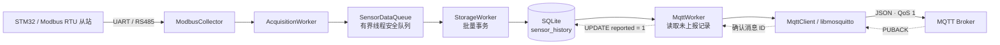

# RK3566 工业边缘网关设备管理系统

**RK3566 Industrial Edge Gateway — Modbus RTU · SQLite · MQTT**

基于 **Linux / C++17** 的工业设备数据采集与边缘转发项目，以 RK3566（Buildroot Linux）为目标平台，连接 STM32 从站，通过 Modbus RTU 轮询传感器寄存器，将采集结果批量持久化至 SQLite，并通过 MQTT QoS 1 上报至 Broker。支持本地缓存、断网恢复补传与运行状态统计。

> **项目状态（截至 2026-11-16）**：核心数据库与 MQTT 模块已有本机自动化测试记录；**当前仓库版本尚未完成 RK3566 平台的完整交叉编译与端到端上板验收**。详见 [MQTT 测试报告](TEST_REPORT_MQTT.md)。

## ✨ 核心特性

- **Modbus RTU 采集**：使用 Linux `termios`、`poll` 等接口实现串口通信，支持功能码 `0x03`（读取保持寄存器）、CRC16 校验、超时处理和串口重连。
- **多线程解耦**：采集线程、SQLite 存储线程、MQTT 上报线程分离，使用有界线程安全队列传递采样数据。
- **SQLite 持久化**：批量事务写入、预编译语句复用、WAL 模式、写入失败退避重试；保留待上传记录。
- **MQTT 可靠上报**：使用 `libmosquitto`、MQTT 3.1.1、QoS 1；收到 PUBACK 后再将对应数据库记录标记为已上报。
- **离线补传**：连接失败或发布确认超时后保留 `reported=0` 的历史记录，下次重新连接或重启时继续补传。
- **可观测性**：提供采集成功/失败、串口重连、队列丢弃、数据库待上报量、MQTT 连接和发布确认等运行统计。

## 🏗️ 系统架构



### 数据流说明

1. `ModbusCollector` 周期性读取 STM32 保持寄存器并解析采样结果。
2. `AcquisitionWorker` 将采样结果放入 `SensorDataQueue`，不直接操作数据库或 MQTT。
3. `StorageWorker` 按批次写入 SQLite；只有已落库记录才进入 MQTT 上报流程。
4. `MqttWorker` 按数据库 `id` 读取 `reported=0` 的记录，转换为 JSON 并发送。
5. QoS 1 发布收到 PUBACK 后，才把对应记录标记为 `reported=1`；未确认记录保留用于补传。

> **可靠性边界**：PUBACK 表示 Broker 在 MQTT 协议层确认发布，不代表业务订阅方已完成处理。QoS 1 允许重复投递，接收端应依据 `gateway_id + record_id` 做幂等去重；有界队列溢出或存储故障仍可能导致尚未落库的采样丢失。

## 🧰 技术栈

| 层次 | 技术 |
| --- | --- |
| 硬件平台 | RK3566（目标平台）、STM32（Modbus 从站） |
| 操作系统 | Linux / Buildroot（目标系统） |
| 编程语言 | C++17、C（第三方 SQLite 源码） |
| 设备通信 | Modbus RTU、UART / RS485、`termios`、`poll` |
| 并发机制 | `std::thread`、`std::mutex`、条件变量、有界队列 |
| 数据存储 | SQLite、WAL、事务、预编译 SQL |
| 网络通信 | MQTT 3.1.1、`libmosquitto`、QoS 1 |
| 数据格式 | nlohmann/json |
| 构建与测试 | CMake、CTest、Python 集成测试 |

## 📁 项目结构

```text
.
├── cmake/                  # ARM64 / Buildroot 交叉编译工具链模板
├── include/                # 各模块的头文件
├── src/
│   ├── main.cpp            # 主程序与线程生命周期管理
│   ├── Modbus_collector.cpp # Modbus RTU 帧收发和解析
│   ├── Acquisition_worker.cpp # 采集线程
│   ├── Storage_worker.cpp # SQLite 批量存储线程
│   ├── Database_manager.cpp # 数据库封装
│   ├── Mqtt_work.cpp       # Mosquitto 客户端与回调
│   └── Mqtt_worker.cpp     # MQTT 上报与补传逻辑
├── tests/                  # 数据库单元测试与 MQTT TCP 集成测试
├── third_party/            # SQLite 和 nlohmann/json 第三方源码
├── scripts/                # 项目辅助脚本
├── CMakeLists.txt
├── README_MQTT.md          # MQTT 实现、配置和验证细节
└── TEST_REPORT_MQTT.md     # 已执行的测试及其边界
```

## 🚀 快速开始

### 1. Ubuntu 本机构建与测试

依赖：C++17 编译器、CMake ≥ 3.16、线程支持、`libmosquitto` 开发文件和 Python 3（用于 MQTT 集成测试）。SQLite 与 nlohmann/json 已由项目 `third_party/` 提供。

```bash
sudo apt update
sudo apt install -y build-essential cmake libmosquitto-dev python3

git clone https://github.com/Feijuyou/rk3566-Industrial-Edge-Gateway-Device-Management-System.git
cd rk3566-Industrial-Edge-Gateway-Device-Management-System

cmake -S . -B build-host -DBUILD_TESTING=ON -DSTATIC_CXX_RUNTIME=OFF
cmake --build build-host -j4
ctest --test-dir build-host --output-on-failure
```

`modbus_app` 的正常采集模式需要可访问的串口设备；如果没有连接 STM32，可先运行数据库测试和 MQTT 集成测试。

### 2. 启动 MQTT Broker（局域网开发示例）

在 Ubuntu 上安装 Broker 与订阅工具：

```bash
sudo apt install -y mosquitto mosquitto-clients
```

按实际网络环境配置监听、访问权限及防火墙。另开终端订阅：

```bash
mosquitto_sub -h 127.0.0.1 -p 1883 \
  -t 'factory/gateway/rk3566-01/telemetry' -q 1 -v
```

> 当前示例针对可信测试网络。仓库当前版本尚未实现 MQTT 账号密码与 TLS，不建议直接暴露到公网。

### 3. 运行程序

**正常模式：采集 + 落库 + MQTT 上报**

```bash
./build-host/modbus_app /dev/ttyS3 sensor_edge.db 192.168.1.100 1883 rk3566-01
```

**仅补传模式：不接串口，上传已有数据库记录**

```bash
./build-host/modbus_app --upload-only sensor_edge.db 127.0.0.1 1883 rk3566-01
```

上述 IP 和串口均为示例，请替换为真实环境。正常模式默认使用从站地址 `1`、保持寄存器 `0x0000`，每 `500 ms` 采集一次；存储线程最多累积 `10` 条或等待 `3 s` 后触发写入。按 `Ctrl+C` 结束程序。

### 4. RK3566 / Buildroot 交叉编译（待实际环境验证）

仓库提供 `cmake/aarch64-buildroot.cmake` 工具链模板，需要 **与开发板固件匹配的交叉工具链、sysroot，以及目标平台的 `libmosquitto` 头文件和库**。不能直接使用 Ubuntu x86_64 的 Mosquitto 库。

```bash
# 将路径替换为实际 SDK 路径
export RK3566_CROSS_COMPILE=/path/to/sdk/bin/aarch64-buildroot-linux-gnu-
export RK3566_SYSROOT=/path/to/sdk/sysroot

cmake -S . -B build-rk3566 \
  -DCMAKE_TOOLCHAIN_FILE=cmake/aarch64-buildroot.cmake \
  -DBUILD_TESTING=OFF
cmake --build build-rk3566 -j4

file build-rk3566/modbus_app
readelf -d build-rk3566/modbus_app
```

> 当前没有已验证的 RK3566 SDK 构建步骤。请在部署前检查架构、动态加载器、C 运行库和 `libmosquitto` 依赖的实际兼容性。更详细的交叉编译说明见 [README_MQTT.md](README_MQTT.md)。

## 🗄️ 数据模型

采样数据保存在 `sensor_history` 表：

```sql
CREATE TABLE IF NOT EXISTS sensor_history (
    id           INTEGER PRIMARY KEY AUTOINCREMENT,
    timestamp_ms INTEGER NOT NULL,
    slave_id     INTEGER NOT NULL,
    reg_addr     INTEGER NOT NULL,
    raw_value    INTEGER NOT NULL,
    scaled_value REAL NOT NULL,
    reported     INTEGER DEFAULT 0
);

CREATE INDEX IF NOT EXISTS idx_reported_id
ON sensor_history(reported, id);
```

其中 `reported=0` 表示尚未完成 MQTT 确认并标记，`reported=1` 表示已收到相应 PUBACK 且数据库更新成功。索引 `(reported, id)` 用于按主键顺序获取待上报数据。

数据库核心行为包括：WAL 日志模式、`synchronous=FULL`、批量事务插入、预编译语句复用和写入失败重试。查询示例：

```sql
SELECT * FROM sensor_history ORDER BY id DESC LIMIT 10;
SELECT COUNT(*) FROM sensor_history WHERE reported = 0;
```

## 📡 MQTT 消息格式

默认 Topic：

```text
factory/gateway/<gateway_id>/telemetry
```

示例 JSON（示意值）：

```json
{
  "gateway_id": "rk3566-01",
  "record_id": 101,
  "slave_id": 1,
  "register": 0,
  "raw_value": 253,
  "value": 25.3,
  "timestamp_ms": 1790000000000
}
```

- **QoS**：1；**retain**：false。
- **在途控制**：当前实现每次最多上报一条等待确认的记录。
- **补传策略**：超时、离线或进程重启后继续处理未标记记录，允许重复投递；接收端需要按业务主键去重。

## ✅ 测试情况

根据仓库内 [TEST_REPORT_MQTT.md](TEST_REPORT_MQTT.md) 的 **2026-11-14 本机测试记录**：

| 项目 | 记录结果 |
| --- | --- |
| CTest 测试组 | 2 / 2 通过 |
| MQTT TCP 集成场景 | 7 / 7 通过 |
| 100 条 JSON 上报测试 | 全部完成确认与标记 |
| 断网 / Broker 离线 / PUBACK 超时 | 本机测试场景覆盖 |
| 进程重启后补传 | 本机测试场景覆盖 |
| RK3566 实机完整链路 | **尚未在当前版本中验证** |
| 真正满盘、掉电与长期稳定性 | **尚未验证** |

> MQTT 集成测试采用本机 TCP 和可控的简化测试 Broker，并不等同于正式 Mosquitto Broker 或真实设备验收。此前的串口通信实验与仓库当前版本的完整上板集成验证也应分别记录。

## 🧭 后续计划

- [ ] 配置与目标 Buildroot 固件匹配的 ARM64 构建环境，完成实机编译部署。
- [ ] 进行 STM32 → RK3566 → SQLite → 正式 Mosquitto Broker 的端到端测试。
- [ ] 完成网络中断、恢复补传、强制退出、掉电与磁盘空间不足等实机场景验收。
- [ ] 增加 MQTT 身份认证、TLS 和外部配置文件。
- [ ] 增加 `systemd` / Buildroot init 服务配置与开机自启。
- [ ] 完成 24 小时以上稳定性测试，并记录内存、CPU 与数据库增长情况。
- [ ] 增加设备及寄存器配置，支持更多 Modbus 从站和数据点。

## 📚 相关文档

- [README_MQTT.md](README_MQTT.md)：MQTT 数据流、PC Broker 配置、交叉编译和上板验证细节。
- [TEST_REPORT_MQTT.md](TEST_REPORT_MQTT.md)：本机自动化测试项目、结果及局限性。

---

**项目定位**：面向 Linux C++ 系统开发与工业物联网场景的工程实践，重点展示串口通信、多线程生产者—消费者模型、数据库持久化、协议确认和异常恢复设计。
